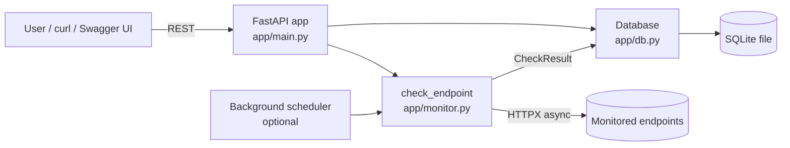

# API Health Monitor

[](https://github.com/iwan-adler/api-health-monitor/actions/workflows/tests.yml)

A small backend service that checks HTTP endpoints, classifies each one as **healthy**, **unhealthy** or **unreachable**, and stores every result in SQLite so you can see history, uptime and response times through a REST API.

## Why

When an app depends on other services (a payment API, an auth server, your own backend), you need to know quickly when one of them is down or slow. Hosted tools like UptimeRobot or Pingdom do this. This project is a self-hosted, minimal version that shows the core mechanics: scheduled HTTP checks, failure classification, persistence and a queryable API.

**Who would use it:** a developer or a small team who wants to keep an eye on a handful of APIs from their own machine or server.

## Features (implemented and tested)

- Add, list, view and delete monitored endpoints, with validated input (`http`/`https` URLs only, timeout 0–60 s, status code 100–599).
- Per-endpoint `GET` or `HEAD` method, expected status code and timeout.
- On-demand checks for one endpoint or for all of them at once (run concurrently).
- Optional background checks every *N* seconds (`CHECK_INTERVAL_SECONDS`).
- Each result records status, HTTP status code, response time (ms), error message and a UTC timestamp.
- Three outcomes:
  | Status | Meaning | Example |
  |---|---|---|
  | `healthy` | Got the expected status code | `200` |
  | `unhealthy` | Got a response with a different status code | `503`, `404` |
  | `unreachable` | No HTTP response at all | DNS failure, connection refused, timeout |
- History per endpoint (newest first) and a `/status` overview with uptime % and average latency over the last 100 checks.
- Endpoints can be bulk-loaded from a JSON config file.
- Interactive API docs at `/docs`.

## Architecture



| File | Responsibility |
|---|---|
| `app/monitor.py` | Sends one request and turns the outcome into a `CheckResult`. No database or web code, so it is easy to test on its own. |
| `app/db.py` | All SQL. Two tables, `endpoints` and `check_results`, with `ON DELETE CASCADE`. |
| `app/schemas.py` | Pydantic models for request validation and response shapes. |
| `app/main.py` | FastAPI routes, app lifecycle (DB init, shared HTTP client, scheduler). |
| `app/load_config.py` | CLI to import endpoints from JSON. |

### Design decisions

- **FastAPI**: validation comes from type hints, and you get auto-generated OpenAPI docs and native `async` support.
- **HTTPX (async)**: the API looks like `requests` but works with `asyncio`, so checking many endpoints runs concurrently. A check of 6 endpoints takes about as long as the slowest one, not the sum of all of them. It also has a `MockTransport` that the tests use to simulate any network failure without touching the internet.
- **Plain `sqlite3`, no ORM**: two tables don't need an ORM, and plain SQL is easy to read and explain. A new short-lived connection per operation keeps it thread-safe with FastAPI's thread pool.
- **Body is never downloaded**: the check streams the response and closes it after the headers arrive. Response time therefore means *time to first response*, and a large page costs no bandwidth.
- **`create_app()` factory**: tests build an isolated app with a temporary database and a fake HTTP client, so they never touch your real data or the network.

## Setup

Requires Python 3.12+ (developed on Python 3.14).

```bash
git clone https://github.com/iwan-adler/api-health-monitor.git
cd api-health-monitor
python -m venv .venv
```

Activate the virtual environment:

```powershell
# Windows PowerShell
.venv\Scripts\Activate.ps1
```
```bash
# macOS / Linux
source .venv/bin/activate
```

```bash
pip install -r requirements.txt
```

## Run

```bash
uvicorn app.main:app --reload
```

Open http://127.0.0.1:8000/docs for interactive API docs.

Configuration (environment variables, all optional):

| Variable | Default | Meaning |
|---|---|---|
| `HEALTH_MONITOR_DB` | `health_monitor.db` | SQLite file path |
| `CHECK_INTERVAL_SECONDS` | `0` (off) | Check all endpoints in the background every N seconds |

```powershell
# PowerShell example: background checks every 60s
$env:CHECK_INTERVAL_SECONDS = "60"; uvicorn app.main:app
```

### Load the sample endpoints

```bash
python -m app.load_config examples/endpoints.json
```

[`examples/endpoints.json`](examples/endpoints.json) includes one endpoint for each outcome: healthy (GitHub API, example.com, the monitor itself), unhealthy (httpbin `503`), a timeout (a non-routable IP) and connection refused (a closed local port). Running it twice is safe because duplicates are skipped.

## API usage

| Method | Path | Description |
|---|---|---|
| `POST` | `/endpoints` | Add an endpoint (`201`, `409` if URL exists, `422` if invalid) |
| `GET` | `/endpoints` | List endpoints |
| `GET` | `/endpoints/{id}` | Get one endpoint (`404` if missing) |
| `DELETE` | `/endpoints/{id}` | Delete endpoint and its history (`204`) |
| `POST` | `/endpoints/{id}/check` | Run a check now and save it |
| `POST` | `/checks/run` | Check all endpoints concurrently |
| `GET` | `/endpoints/{id}/checks?limit=50` | History, newest first (`limit` 1–500) |
| `GET` | `/status` | Latest result, uptime % and avg latency per endpoint |
| `GET` | `/health` | Health of the monitor itself |

```bash
curl -X POST http://127.0.0.1:8000/endpoints \
  -H "Content-Type: application/json" \
  -d '{"name": "GitHub API", "url": "https://api.github.com", "timeout_seconds": 5}'

curl -X POST http://127.0.0.1:8000/endpoints/1/check
```

Example result (captured from a real run):

```json
{"id": 3, "endpoint_id": 2, "status": "healthy", "status_code": 200,
 "response_time_ms": 183.21, "error": null,
 "checked_at": "2026-10-12T15:28:45.636509+00:00"}
```

A timeout looks like:

```json
{"id": 7, "endpoint_id": 7, "status": "unreachable", "status_code": null,
 "response_time_ms": null, "error": "Timed out after 2.0s",
 "checked_at": "2026-10-12T15:28:56.420805+00:00"}
```

## Tests

```bash
python -m pytest
```

The suite has 47 tests and runs offline in a few seconds. Apart from one test that connects to a closed local port, it uses HTTPX's `MockTransport` instead of the network. It covers:

- Each outcome: healthy, unhealthy, timeout, connection error, protocol error, redirects, custom expected status, `HEAD` method.
- Input validation: bad URLs, non-HTTP schemes, blank or too-long names, out-of-range timeout and status code, plus boundary values that must be accepted.
- `404`/`409` handling, history ordering and `limit` validation, uptime calculation, cascade delete.
- Persistence across an app restart, and the background scheduler.
- The config loader, including duplicates and invalid entries.

## Limitations

- **No authentication.** Anyone who can reach the API can add endpoints. Keep it on `127.0.0.1` (Uvicorn's default) and don't expose it publicly as-is.
- **SSRF risk if exposed:** the service will request any URL it's given, including internal addresses. A public deployment would need auth plus a URL allow-list or private-IP blocking.
- No alerting (email, Slack, ...). You have to query `/status`.
- History grows without limit, with no retention or cleanup yet.
- SQLite with a single process. That's fine for dozens of endpoints but not built for multi-instance deployment.
- A check counts only the status code. It doesn't validate the response body.

## Next steps

1. Alerting when an endpoint changes state (healthy → unhealthy), via webhook or email.
2. A retention policy (for example, keep 30 days of results).
3. API-key authentication and private-IP blocking for safe deployment.
4. A minimal HTML dashboard over `/status`.
5. Response-time percentiles (p95) and a configurable "slow" threshold.
